<div align="center">

<picture>
  <source media="(prefers-color-scheme: dark)" srcset="docs/figures/wordmark-dark.svg">
  
</picture>

<p><i>A self-hosted library for the links you save.</i></p>

<p>
  <a href="https://github.com/meillaya/eza/stargazers"></a>
  <a href="https://github.com/meillaya/eza/actions/workflows/ci.yml"></a>
  <a href="LICENSE"></a>
  <a href="https://www.haskell.org"></a>
  <a href="https://haskell-miso.org"></a>
  <a href="https://sqlite.org/fts5.html"></a>
</p>

<picture>
  <source media="(prefers-color-scheme: dark)" srcset="docs/screenshots/library-dark.png">
  
</picture>

</div>

eza keeps bookmarks in SQLite and serves searchable private libraries from one
Haskell process. A control database holds the account list, and every account has
a private SQLite library, so a household shares one server without sharing a
shelf. The client is Miso compiled to WebAssembly, search runs on SQLite FTS5,
and the reference library behind these screenshots holds 9,226 bookmarks across
4,521 sources filed since 2022. A 14,582-row benchmark library answers full-text
search at 0.92 to 2.00 ms p95.

---

## 📸 Screenshots

The real server and the built WASM client, against a scratch copy of the
reference library. Paper on the left, the reading room at night on the right.

| Paper | Reading room |
|:---:|:---:|
|  |  |
|  | 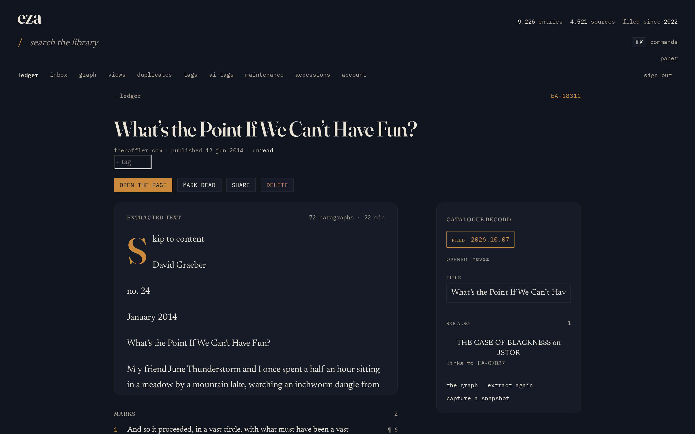 |
| 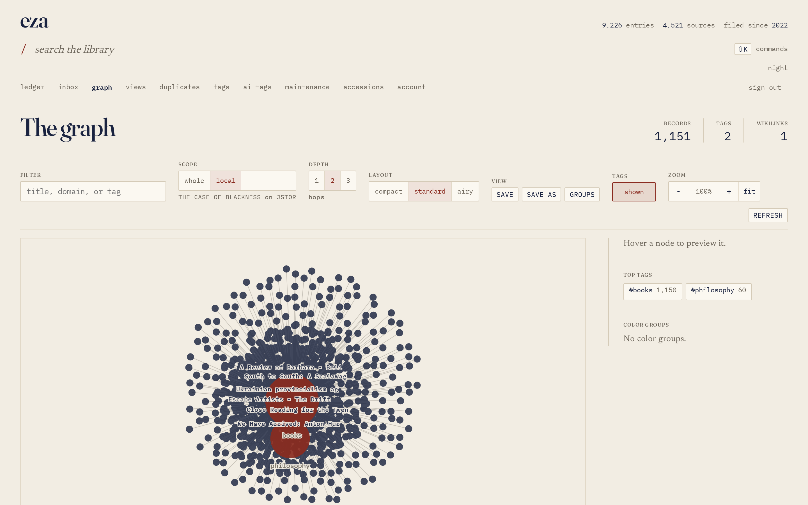 | 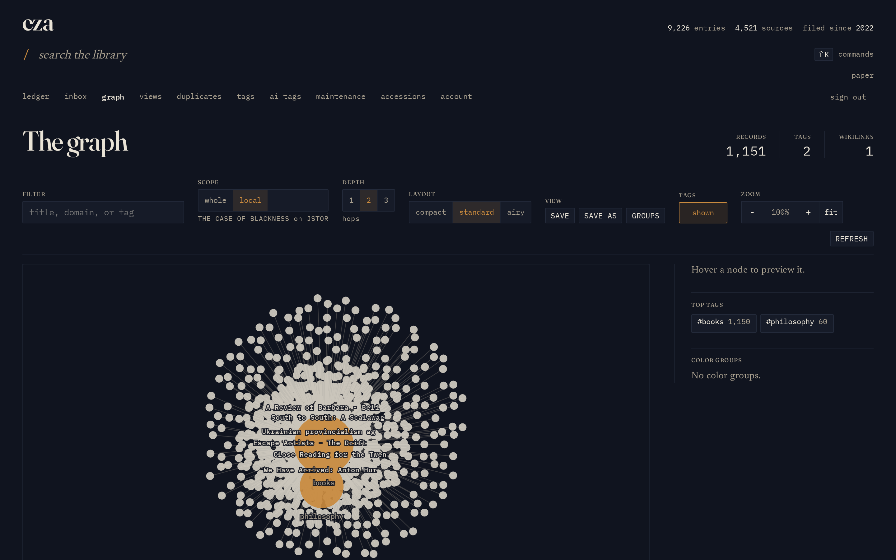 |
| 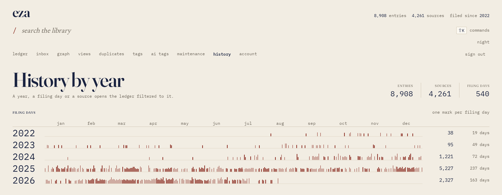 | 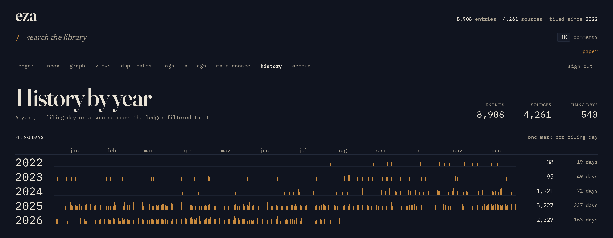 |
|  | 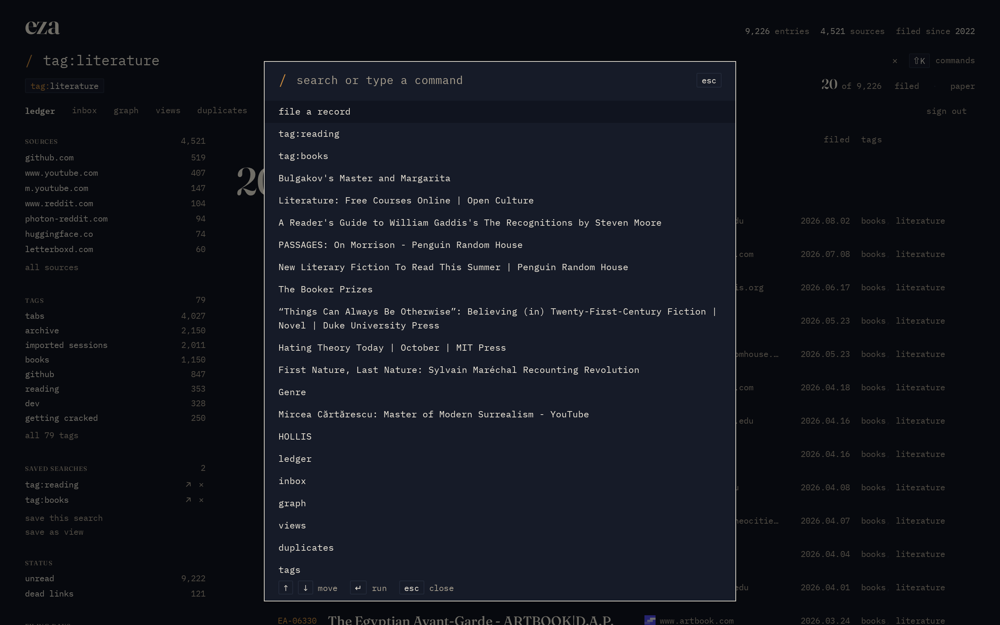 |
| 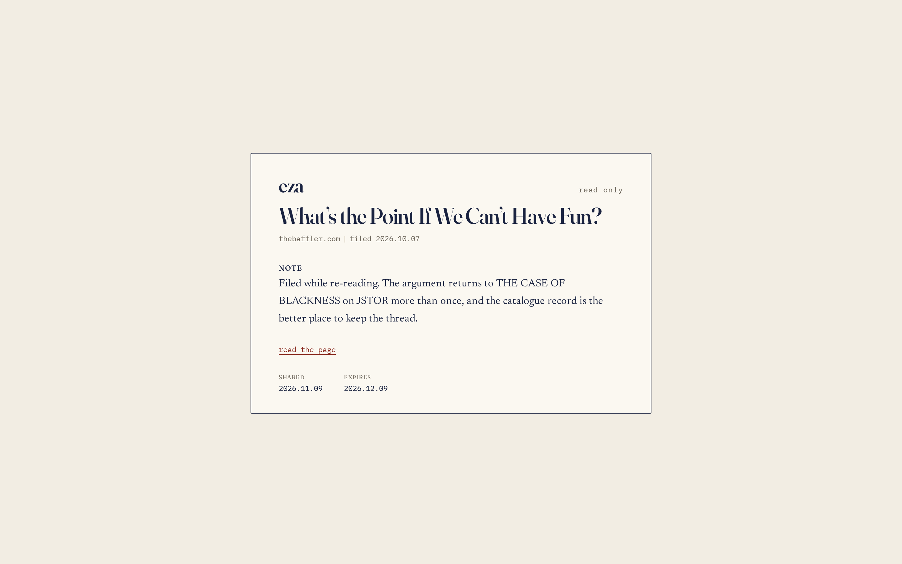 | 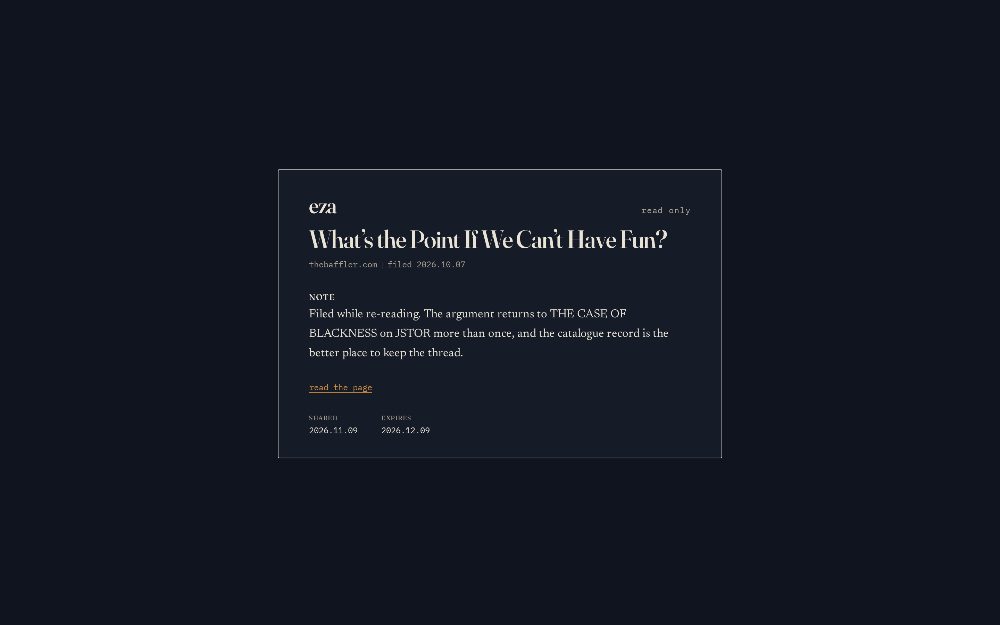 |
| 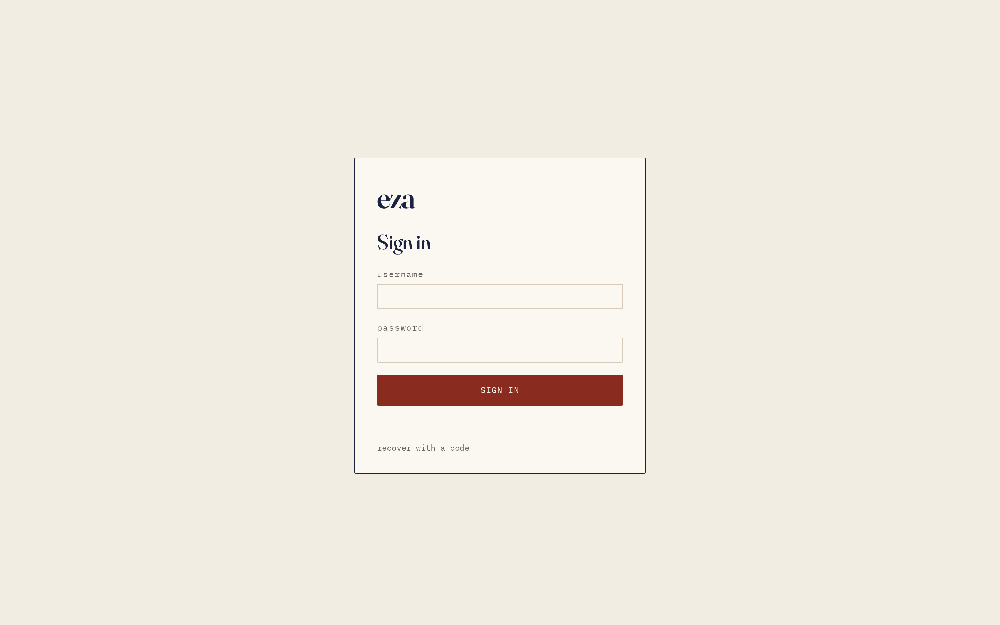 | 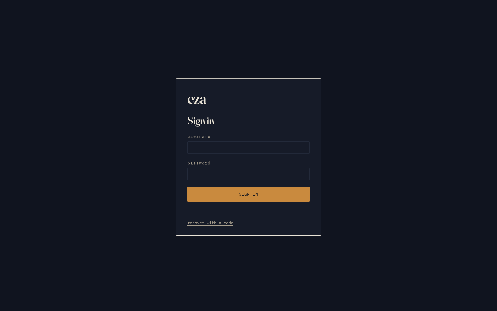 |

---

## 📦 Installation

### Quick start (Docker)

The published image is multi-arch (`linux/amd64` and `linux/arm64`). A fresh
install is one command:

```bash
docker run -d --name eza --restart unless-stopped \
  -p 8080:8080 -v eza-data:/data \
  ghcr.io/meillaya/eza:latest
```

Open <http://localhost:8080/setup> and create the first account. The named
`eza-data` volume holds the control database, account libraries, snapshots and
backups; keep it across upgrades. For a remote host, set
`-e PUBLIC_ORIGIN=https://your-host` and put a TLS proxy in front; passkeys
need a secure origin or localhost. See
[docs/deployment-docker.md](docs/deployment-docker.md) for Compose, backups,
upgrades and troubleshooting.

Existing installs upgrade by backing up, pulling the new image and recreating
the container with the same volume:

```bash
docker exec eza eza-bookmarks backup
docker pull ghcr.io/meillaya/eza:latest
docker rm -f eza
docker run -d --name eza --restart unless-stopped \
  -p 8080:8080 -v eza-data:/data \
  ghcr.io/meillaya/eza:latest
```

### Quick start (Nix)

With flakes enabled, build the server and the pinned web bundle without Docker:

```bash
nix build github:meillaya/eza#eza-bookmarks --out-link eza-server
nix build github:meillaya/eza#eza-web --out-link eza-web

EZA_STATIC_DIR=$PWD/eza-web/share/eza/static \
EZA_DATA_DIR=$PWD/eza-data \
PUBLIC_ORIGIN=http://localhost:8080 \
./eza-server/bin/eza-bookmarks serve
```

Open <http://localhost:8080/setup>. The `eza-data` directory is the persistent
state; back it up like any other SQLite data directory. For a permanent NixOS
install use the module below instead.

### Quick start (devenv / source)

For development or a source checkout:

```bash
git clone https://github.com/meillaya/eza
cd eza
devenv shell -- build      # native server + Miso/WASM client
devenv shell -- dev        # http://localhost:8000
```

Open <http://localhost:8000> and claim the first account at `/setup`. The dev
server stores data under the checkout's `data/` directory. See
[From source](#from-source) for the individual `web`, `test`, `lint` and `e2e`
commands.

> [!IMPORTANT]
> The Nix and Docker outputs build the web client from the same commit inside
> the deployment flake: `nix/eza-web.nix` pins the WASM toolchain and an offline
> Hackage dependency set, compiles the Miso client and bundles the
> content-addressed assets with `scripts/bundle-web.sh`. There is no separately
> published web bundle or SRI pin to update. A `v*` tag runs
> `.github/workflows/release.yml` to create the release, then
> `.github/workflows/release-image.yml` to publish the container image and its
> versioned compose file; the container image is the installable artifact.

One Warp and WAI process serves the client assets, the auth and share pages and
`/api/v1`. The control database owns identity only; each account has a private
SQLite library in WAL mode under `EZA_DATA_DIR/users/<id>/`, and a request
resolves its account before it reads a row. Backups are directory stamps of the
control database and every account library.

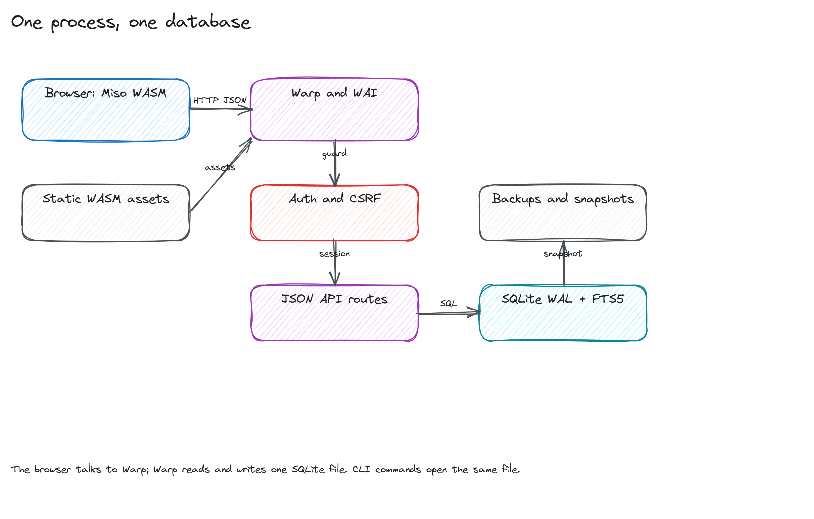

| Route | Best for | What you get |
|---|---|---|
| [NixOS module](#nixos-module) | a NixOS host | hardened systemd unit, Caddy, daily backup timer |
| [Docker Compose](#docker-compose) | one Linux host | one container, one named volume |
| [From source](#from-source) | trying it out or developing | the devenv toolchain, no install |

### NixOS module

Add the deployment flake input:

```nix
{
  inputs = {
    nixpkgs.url = "github:NixOS/nixpkgs/nixos-unstable";
    eza = {
      url = "github:meillaya/eza";
      inputs.nixpkgs.follows = "nixpkgs";
    };
  };

  outputs = { nixpkgs, eza, ... }: {
    nixosConfigurations.host = nixpkgs.lib.nixosSystem {
      system = "x86_64-linux";   # or aarch64-linux
      modules = [ eza.nixosModules.default ./configuration.nix ];
    };
  };
}
```

Then enable the service. This example puts Caddy's automatic HTTPS in front of
the loopback listener and sets the public origin to the same hostname:

```nix
{
  services.eza = {
    enable = true;
    publicOrigin = "https://eza.example.com";
    rpId = "eza.example.com";   # host only, no scheme or port
    caddy = { enable = true; hostname = "eza.example.com"; };
    backup.enable = true;       # daily online backup at 03:17
  };

  networking.firewall.allowedTCPPorts = [ 80 443 ];
}
```

The module's default web assets are built from the same flake input, so no
separate step is needed. To serve a checkout build instead, build the bundle
and point `staticDir` at the directory that contains `asset-manifest.json`:

```bash
devenv shell -- web
sudo install -d /srv/eza/static
sudo cp -a static/. /srv/eza/static/
```

```nix
services.eza.staticDir = "/srv/eza/static";
```

Then switch and open the origin:

```bash
sudo nixos-rebuild switch --flake .#host
```

The module owns `dataDir` (`/var/lib/eza`), `bind` (`127.0.0.1:8080`),
`environmentFile` and separate API-key file options. The full option list is in
[docs/deployment-nixos.md](docs/deployment-nixos.md#options).

### Docker Compose

The checked-in stack pulls the published image:

```bash
cp deploy/docker-compose.yml docker-compose.yml
# edit PUBLIC_ORIGIN in the file, then:
docker compose up -d
```

The container runs as uid and gid 10001, keeps `/data` on a named volume and
serves the `/healthz` probe. Put a TLS proxy in front for passkeys. To build the image locally instead,
run `nix build .#docker` and set `EZA_IMAGE=eza:0.4.0.0`.

### From source

Nix and devenv provide GHC 9.10, the WASM toolchain and the command surface.
There is no Makefile:

```bash
git clone https://github.com/meillaya/eza
cd eza
devenv shell -- build   # native server + Miso/WASM client
devenv shell -- web     # client only, if you already built the server
devenv shell -- dev     # http://localhost:8000
```

Open <http://localhost:8000> and claim the first account at `/setup`. The
individual checks are:

```bash
devenv shell -- test    # server tests
devenv shell -- lint    # fourmolu + hlint
devenv shell -- docs    # documentation and version drift checks
devenv shell -- spec    # TLA+ models and JSON schemas
devenv shell -- e2e     # Playwright browser suite
```

### Configuration

| Variable | Default | Meaning |
|---|---|---|
| `PUBLIC_ORIGIN` | `http://localhost:8080` | Browser-visible origin. Set the final HTTPS origin before the first claim. |
| `EZA_RP_ID` | host of `PUBLIC_ORIGIN` | WebAuthn relying-party ID: host only, no scheme or port. |
| `EZA_DATA_DIR` | `./data` server, `/data` image, `/var/lib/eza` module | `control.db`, `users/<id>/eza.db` and `backups/`. |
| `EZA_BIND` | `127.0.0.1:8080` server, `0.0.0.0:8080` image | Warp listen address. |
| `EZA_AI_PROVIDER` | `none` | `none`, `ollama`, `openai`, `openai-compatible` or `anthropic`. |
| `ANTHROPIC_API_KEY`, `OPENAI_API_KEY` | unset | Optional AI tagging keys. Absent is fine. |

The full list is in
[docs/deployment-docker.md](docs/deployment-docker.md#environment-variables).

### First run and backups

The first visit to `/setup` creates the admin account and shows ten one-time
recovery codes; they are the way back in if the password is lost. Passkeys bind
to `PUBLIC_ORIGIN` and `EZA_RP_ID`, so set the final origin before enrolling
them. Changing the origin later invalidates existing passkeys and requires
recovery.

Backups belong to the route: the NixOS module has a daily timer, the container
writes one with `docker compose exec eza /bin/eza-bookmarks backup`, and a
checkout runs `devenv shell -- cabal run eza-bookmarks -- backup`. A stamp holds
`control.db`, `manifest.json` and every account library, disabled accounts
included. Restore with the server stopped and the same binary, for example:

```bash
docker compose stop eza
docker compose run --rm eza /bin/eza-bookmarks restore /data/backups/<stamp> --yes
```

---

## ✨ Features

- [x] Full-text search over title, description, URL, note, extracted text and source domain
- [x] `tag:`, `is:unread`, `is:dead`, `link:`, `year:`, `day:` and `-term` filters, ordered by bm25
- [x] Ledger with accession numbers, year dividers, source and tag facets and a field drawer
- [x] Inbox, saved searches and a command palette
- [x] History index by year, filing day and source
- [x] Graph of records, tags and wikilinks with pan, zoom, focus and layout presets
- [x] One cached favicon per source domain, with a printed monogram fallback
- [x] Extracted reading copy in a bounded window, editable when extraction is mangled
- [x] Highlights with notes and colours
- [x] Markdown notes with `[[wikilinks]]`, backlinks and unlinked mentions
- [x] Page snapshots with a CSP-sandboxed viewer
- [x] Duplicate groups with merge and merge-all
- [x] Tag merge, rename and detach, with snapshots
- [x] Bounded dead-link sweeps, manual keep-alive, and prune candidates
- [x] Undo history with per-action preview, plus snapshots for merges, tag changes, prune and deletes
- [x] Chromium MV3 clipper, clip and quick-save APIs, bookmarklet and PWA share target
- [x] JSON-lines extraction sidecar for the clipper
- [x] Read-only share links for records and searches, and Atom feeds for searches
- [x] Netscape and eza JSON import, plus whole-library export
- [x] One private library per account, Argon2id passwords, login rate limits and recovery codes
- [x] Optional passkey second factor and hashed sessions
- [x] Scoped API tokens, CSRF and origin checks, admin and member roles
- [x] Online backup stamps and offline restore
- [x] NixOS module, Docker image, Compose stack and Caddy
- [x] `/healthz` probe, hardened unit and static asset caching

---

## 🧩 Extensions

Extensions v1 are data, not code. A view is a JSON document that the server
validates and the client renders; a webhook is a URL the server posts signed
events to. There is no plugin loader, no script host and no third-party
extraction code. Each view and webhook belongs to one account database, and
unknown schema versions or kinds are rejected.

### Views

A view stores a graph or ledger definition with one default per kind. Register
one with a token that has the write scope:

```json
{
  "name": "Unread graph",
  "kind": "graph",
  "definition": {
    "query": "is:unread",
    "tags_shown": true,
    "label_mode": "auto",
    "layout_preset": "standard",
    "local_depth": 2,
    "color_groups": []
  }
}
```

```bash
curl -sS -X POST https://eza.example/api/v1/views \
  -H "Authorization: Bearer $EZA_TOKEN" \
  -H 'Content-Type: application/json' \
  --data @view.json
```

Limits are 64 views per account database, a 512-character query and 24 colour
groups per graph view. Unknown kinds and schema versions return `400
bad_request`. The [extension contract](docs/extensions.md) has the full shapes.

<div align="center">
  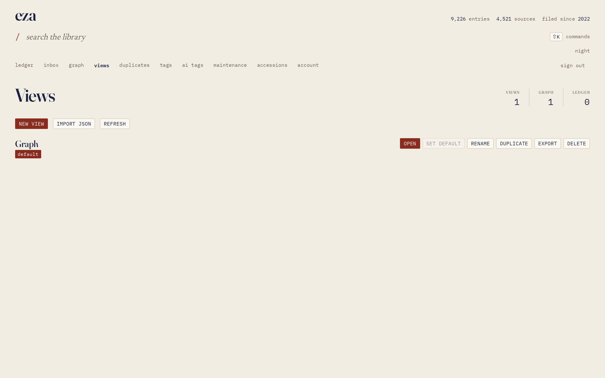
  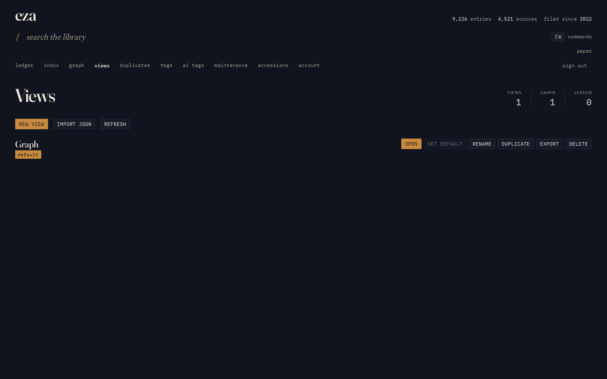
</div>

### Webhooks

Subscriptions are managed over a browser session, never a bearer token:

```json
{
  "name": "Inbox bridge",
  "url": "https://example.com/hooks/eza",
  "events": ["bookmark.created", "clip.created"],
  "enabled": true
}
```

Events are `bookmark.created`, `bookmark.updated`, `bookmark.deleted` and
`clip.created`. Each delivery carries `X-Eza-Event`, `X-Eza-Delivery`,
`X-Eza-Timestamp` and `X-Eza-Signature`, where the signature is
`sha256=<HMAC>` over `<timestamp>.<body>` with the secret returned once on
create. Deliveries are at least once: each event is attempted five times with
backoff, then the subscription is disabled. Limits are 16 webhooks per account
database, http and https only, and private addresses are refused unless
`EZA_ALLOW_PRIVATE_FETCH` is set.
Details and the event catalogue are in [docs/extensions.md](docs/extensions.md).

### Clipper

The Chromium MV3 clipper extracts the readable page in the browser and posts a
typed clip to `/api/v1/clip` with a capture token. Load `extension/` unpacked for
the no-build version with the built-in extractor, or bundle Defuddle for better
extraction:

```bash
bash scripts/build-extension.sh --with-defuddle   # writes extension/dist
```

`Ctrl+Shift+Y` saves the page, `Ctrl+Shift+U` saves the selection; the token lives
in the extension and is sent only as a bearer header. The bookmarklet opens
`/save`, a PWA share target backs the mobile route, and an optional JSON-lines
Node sidecar (`EZA_DEFUDDLE_CMD`) handles extraction for the server. See
[extension/README.md](extension/README.md) and [docs/clipper.md](docs/clipper.md).

---

## 📚 Documentation

| Document | What is in it |
|---|---|
| [docs/API.md](docs/API.md) | Routes, auth and scopes, status codes, DTO reference |
| [CHANGELOG.md](CHANGELOG.md) | Release notes and the one-way 0.4 upgrade summary |
| [docs/upgrade.md](docs/upgrade.md) | Upgrade from 0.3 to 0.4: backup, schema map, Docker/NixOS/source steps, verify and rollback |
| [docs/release.md](docs/release.md) | Release version bump, gates, one-way upgrade drill, tag/publish and post-release checks |
| [docs/architecture.md](docs/architecture.md) | Data layout, request path, import math, search model, storage invariants |
| [docs/UI.md](docs/UI.md) | Tokens, type, layout, screens, keyboard, accessibility, voice |
| [docs/import.md](docs/import.md) | Netscape import rules and the reference result |
| [docs/clipper.md](docs/clipper.md) | Clipper, clip API, CORS origins, sidecar and templates |
| [docs/extensions.md](docs/extensions.md) | View and webhook contract, limits, delivery and threat model |
| [docs/performance.md](docs/performance.md) | Benchmark method, raw output and limits |
| [docs/deployment-nixos.md](docs/deployment-nixos.md) | Flake input, module options, unit, backup timer and the in-Nix web build |
| [docs/deployment-docker.md](docs/deployment-docker.md) | Image build, Compose, environment, healthcheck and secrets |
| [docs/secrets.md](docs/secrets.md) | SecretSpec manifest and provider setup |
| [docs/figures/README.md](docs/figures/README.md) | Excalidraw sources, generators, render script and wordmark |
| [docs/screenshots/README.md](docs/screenshots/README.md) | Screenshot provenance and capture procedure |
| [extension/README.md](extension/README.md) | Clipper install, options, shortcuts and security notes |

---

<details>
<summary><b>⌨️ Keyboard shortcuts</b></summary>

| Key | Action |
|---|---|
| `/` | Focus the search line |
| `Shift+K`, `Cmd+K`, `Ctrl+K` | Open the command palette from any screen (`Ctrl/Cmd+K` works while the search line has focus) |
| `j`, `k` | Move the ledger cursor and open the field drawer |
| `Enter` | Open the record under the cursor, run the palette item, or open the focused graph node |
| `+`, `-` | Zoom the graph in and out |
| `0`, `f` | Fit the whole graph in the canvas |
| Arrow keys | Pan the graph; `Shift` moves a larger step |
| `Esc` | Close the palette, drawer or dialog; on the graph, clear the filter and selection |
| `Cmd+S`, `Ctrl+S` | Save the note on the record page |

Graph keys apply on `/graph`, with no dialog layer and no text field focused. The
hint under the search line is a `⇧K` button. Sign out lives at the end of the
section links, in the mobile bar, on the account page and in the palette.

</details>

---

## 🆘 Help

- Read the [documentation](#-documentation) above, especially the deployment
  guides.
- The server logs to stderr; `EZA_LOG_LEVEL=debug` turns on access logging, and
  `/healthz` is the container probe.
- Bugs and questions: [open an issue](https://github.com/meillaya/eza/issues).

## 💖 Credits

eza stands on a lot of good work:

- [Miso](https://haskell-miso.org) for the Haskell WebAssembly client, and the
  GHC 9.14 WebAssembly backend.
- [Warp and WAI](https://hackage.haskell.org/package/warp) for the server, and
  [SQLite](https://sqlite.org/fts5.html) for the storage engine and FTS5.
- [monolith](https://github.com/Y2Z/monolith) for page snapshot capture.
- [Defuddle](https://github.com/kepano/defuddle) for the optional clipper
  extraction bundle.
- [Fraunces](https://fonts.google.com/specimen/Fraunces),
  [Newsreader](https://fonts.google.com/specimen/Newsreader) and
  [IBM Plex Mono](https://fonts.google.com/specimen/IBM+Plex+Mono), under the SIL
  Open Font License.
- [Excalidraw](https://excalidraw.com) for the architecture figures.
- And you, for keeping your own shelf.

---

<div align="center">
<sub>Apache-2.0 · <a href="THIRD-PARTY-NOTICES.md">Third-party notices</a> · built with Haskell, Miso, SQLite and Nix</sub>
</div>
