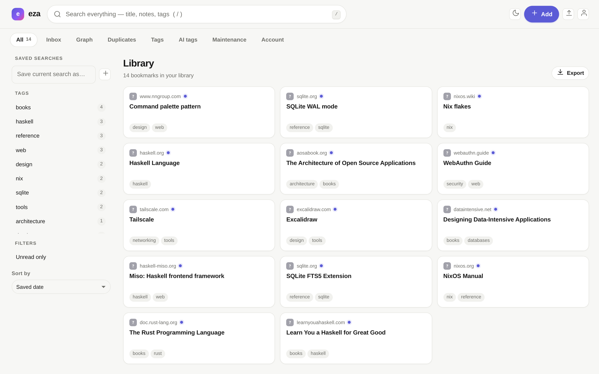
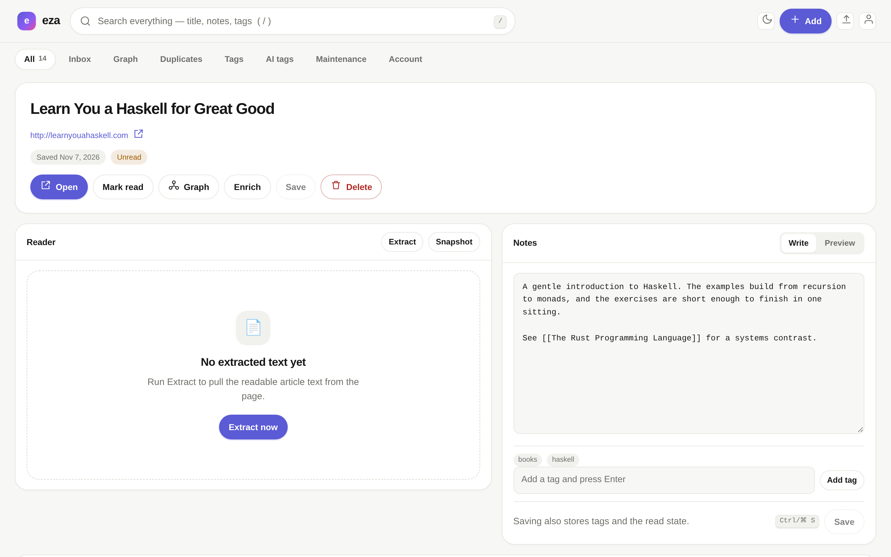
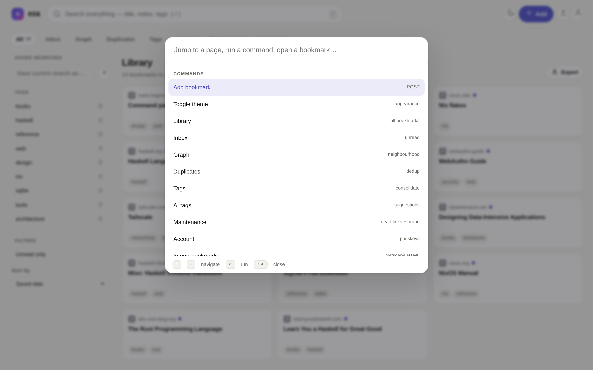
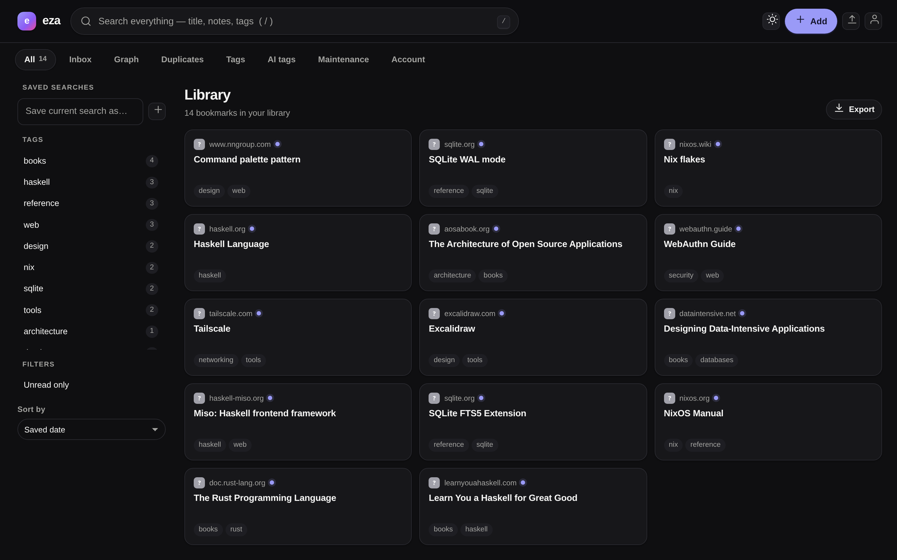

<div align="center">


<h1 align="center">eza</h1>

<p align="center">A self-hosted bookmark library that stays fast at 10,000 links.</p>

<p>
  <a href="LICENSE"></a>
  <a href="https://www.haskell.org"></a>
  <a href="https://haskell-miso.org"></a>
  <a href="https://sqlite.org/fts5.html"></a>
  <a href="docs/deployment-nixos.md"></a>
</p>



</div>

eza stores bookmarks in SQLite and serves a searchable library from one
Haskell process. It is built for one person with thousands of links: the
reference database holds 8,988 bookmarks, 75 tags, and 21,316 tag links.
Search runs on FTS5, the client is Miso compiled to WebAssembly, and passkeys
replace passwords.

The interface puts search, tags, notes, and backlinks on one screen. It has
light and dark themes, a command palette, a graph view, duplicate detection,
dead-link checks, and an undo stack for destructive actions.

---

## What you get

| Area | What it does |
|---|---|
| **Search** | `tag:`, `is:unread`, `is:dead`, `link:`, and `-term` operators over FTS5. Results order by bm25, then save date. |
| **Library** | A virtualized card grid, a tag rail with counts, saved searches, and unread and dead filters. |
| **Reading** | Extracted article text, a notes editor with markdown preview, `[[wikilinks]]`, and backlinks. |
| **Maintenance** | Duplicate groups, tag consolidation, dead-link sweeps, and a prune flow. Every merge or prune writes an undo snapshot. |
| **Capture** | Add a bookmark by URL, import a Netscape export, or let the importer fetch metadata with `enrich`. |
| **Access** | WebAuthn passkeys, ten recovery codes, per-session CSRF checks, and a deny-by-default API. |
| **Ownership** | One SQLite file, WAL mode, online backups, a Docker image, a NixOS module, and Kubernetes manifests. |

<div align="center">



<sub>The detail view keeps the reader, notes, tags, and backlinks in one place.</sub>

</div>

---

## Quick start

You need Nix and devenv.

```bash
devenv shell
bash scripts/build-web.sh
cabal run eza-bookmarks -- serve
```

Open <http://localhost:8080>. The first page is `/setup`: register a passkey
and save the ten recovery codes. This working copy contains `data/eza.db` with
the 2026-08-14 import and no registered passkey, so setup runs on the first
boot.

For a host other than localhost, set `PUBLIC_ORIGIN` and `EZA_RP_ID` before
you register a passkey. The origin is part of the credential, so changing it
later requires recovery or a new setup.

The same binary runs the import and maintenance commands:

```bash
eza-bookmarks import netscape bookmarks_14_08_2026.html --report dist/import.json
eza-bookmarks verify
eza-bookmarks backup
eza-bookmarks check-dead --limit 200
```

To build a database from scratch, run `eza-bookmarks init` before the import.
The import is idempotent: a second run reports `inserted=0`.

<div align="center">




<sub>Press <code>k</code> for the command palette. Toggle the theme from the top bar.</sub>

</div>

---

## How it fits together

One Warp/WAI process serves the client assets, the auth pages, and
`/api/v1`. Every API request passes a deny-by-default route table. Unsafe
methods also require the `X-CSRF-Token` header. SQLite runs in WAL mode with
FTS5 triggers over the title, description, URL, note body, and extracted text.
The CLI opens the same database file for import, export, verification, and
backup.

<div align="center">


</div>

The 2026-08-14 export contains 9,457 anchors. The importer skips 4 non-http
anchors, collapses 465 duplicate anchors, and writes 8,988 bookmarks, 75 tags,
and 21,316 tag links in one transaction. The equations and storage rules are in
[docs/architecture.md](docs/architecture.md).

---

## Performance

Measured on an AMD Ryzen 7 5700X with GHC 9.10.3 and `-O1`, against the
8,988-row database:

| Query | p95 |
|---|---|
| `all` | 0.67 ms |
| `fts-rust` | 0.86 ms |
| `fts-github` | 1.19 ms |
| `tag-imported` | 12.15 ms |
| `tag-imported-books` | 9.52 ms |

Run the same benchmark:

```bash
EZA_DATA_DIR=$PWD/data EZA_DB=$PWD/data/eza.db \
  cabal run eza-bookmarks -- bench --iterations 20
```

The method and raw output are in [docs/performance.md](docs/performance.md).

---

## Deploy

The deployment flake builds the server, the NixOS module, and a local Docker
image. The Docker image runs as uid 10001, keeps state under `/data`, and
uses `eza-bookmarks healthcheck` for its health check. The Kubernetes
manifests run one replica with a ReadWriteOnce volume, because SQLite has one
writer.

<div align="center">


</div>

| Target | Guide |
|---|---|
| NixOS module and systemd unit | [docs/deployment-nixos.md](docs/deployment-nixos.md) |
| Docker image and compose | [docs/deployment-docker.md](docs/deployment-docker.md) |
| Kubernetes manifests | [docs/deployment-k8s.md](docs/deployment-k8s.md) |
| Tailscale Serve and HTTPS | [docs/tailscale.md](docs/tailscale.md) |
| SecretSpec and API keys | [docs/secrets.md](docs/secrets.md) |

The flake has no devShell. Use `devenv.nix` for development and the flake for
deployment outputs. The release web-asset path expects a published
`eza-web-<version>.tar.gz` and its SRI hash; the local targets
(`.#eza-web-local`, `.#docker-local`) use `./static` and need no release
asset.

---

## Documentation

| Document | Contents |
|---|---|
| [docs/architecture.md](docs/architecture.md) | Request path, import math, search model, storage invariants |
| [docs/API.md](docs/API.md) | Auth, library, tags, maintenance, account, and DTO reference |
| [docs/UI.md](docs/UI.md) | Layout, tokens, screens, accessibility, and shortcuts |
| [docs/import.md](docs/import.md) | Netscape import rules and the reference result |
| [docs/performance.md](docs/performance.md) | Benchmark method, raw output, and limits |
| [docs/figures](docs/figures/README.md) | Excalidraw sources, generator, and render script |

## Keyboard shortcuts

| Key | Action |
|---|---|
| `/` | Focus search |
| `k` | Open the command palette |
| `Esc` | Close the palette or a dialog |
| arrows, Enter | Move and confirm in the palette |
| Ctrl+S, Cmd+S | Save the current bookmark |

---

<div align="center">
<sub>Apache-2.0 · Built with Haskell, Miso, SQLite, and Nix</sub>
</div>
