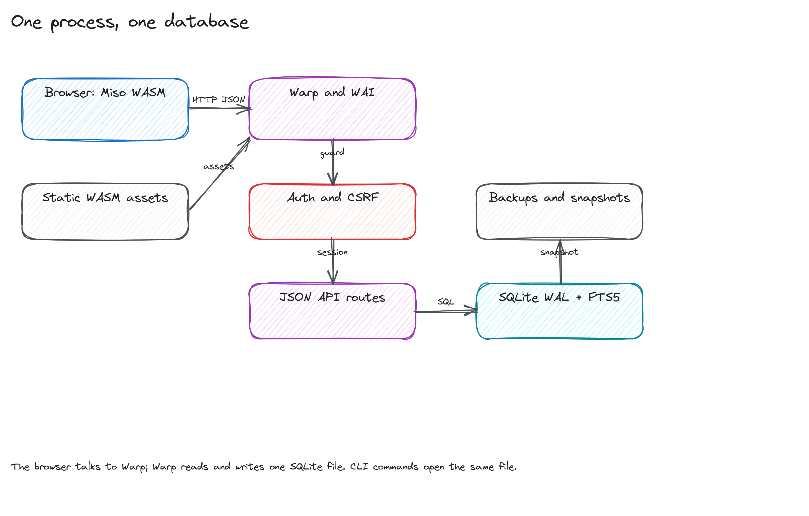
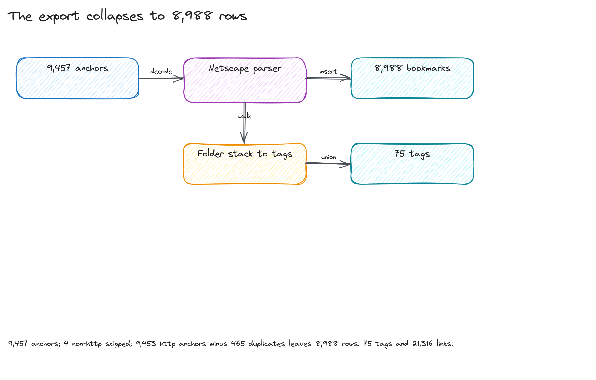
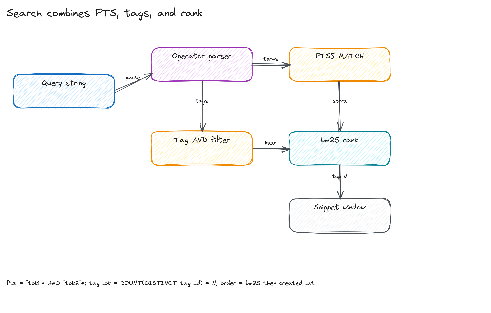

# Architecture

eza runs one Haskell process, serves one WebAssembly client, and stores each
account's rows in its own SQLite file behind a shared control database. This
document explains the data layout, the request path, the import math, the
search model, and the deployment shape.

## One process, one control file, one library per account

A Warp/WAI process owns the HTTP surface. It serves `/assets/*` from
`EZA_STATIC_DIR`, renders the login/setup/recovery pages, and answers
`/api/v1/*` for every account.

Data lives in two shapes under `EZA_DATA_DIR`:

```
control.db                     accounts: username, role, db_path, handle, state
users/<id>/eza.db              one account's library (the full schema)
users/<id>/snapshots/          that account's captured pages
backups/<stamp>/control.db          a backup run's control database
backups/<stamp>/manifest.json       accounts captured by that run
backups/<stamp>/users/<id>/eza.db   a backup run's library files
```

`control.db` (`EZA_CONTROL_DB`) holds identity only: a row per account with a
unique case-insensitive username, an `admin`/`member` role, the path to the
account's library, a per-account WebAuthn user handle, and timestamps for
creation, disablement, and last login. `users/<id>/eza.db` (`EZA_USERS_DIR`)
holds everything else. Requests open library databases lazily: an
`Eza.Library` owns one write connection behind an `MVar`, a small read-only
pool, the graph layout cache and the account's worker handles; the number of
open slots is capped by `EZA_MAX_USERS`. Authentication runs on the read pool:
a session or token is validated by a SELECT, and `last_seen_at`/`last_used_at`
are written as a throttled activity touch (at most once per minute) only when
the stored timestamp is stale, so a normal GET never touches the writer.

Every API route is classified by `Eza.Routes` and enforced by `Eza.Authz`, the
single authorization matrix: a request without a guard returns 401 and admin
routes accept only admin browser sessions. Unsafe methods also require the
`X-CSRF-Token` header. Session,
pending, share, and API tokens carry the owning account id in their prefix
(`u<id>_...`, `eza_pat_u<id>_...`); the guard resolves that id through the
control database and then verifies the token hash in that account's library,
so a rewritten prefix fails. A token without a prefix is accepted only while
exactly one enabled account exists, which keeps pre-M3 sessions working after
the startup migration. The control database is never a content path: handlers
only ever see the signed-in account's connection.

Login resolves the username through the control database. An unknown or
disabled username pays a dummy Argon2 hash and returns the same generic 401 as
a wrong password, and attempts are capped per client host and username. Each
account stores its Argon2id password hash and only the SHA-256 hash of each
session token, and its own login counters in `app_state`. A password account
can register passkeys and enable a second factor; a password login then
returns a short-lived pending session and requires a WebAuthn assertion before
a normal session is created. Pending scopes cannot reach `/api/v1`. Recovery
requires a username and clears that account's password, passkeys, and flag.

Startup migration: when the control database has no rows and `EZA_DB` exists
with a claimed account, that file is registered as user 1 with the admin role
in place, with no copy or move; removing `control.db` rolls the registration
back. An unclaimed legacy file is left alone. Otherwise the first
`/setup` claims a fresh account under `users/<id>/`.

Background work is per account. The slot supervisor starts and owns each
account's worker set through `Eza.Library`: the enrichment claimers, the
webhook delivery worker (each database has its own outbox and cursor), and one
favicon backfill loop. Worker threads open their database connection through a
bracket, so cancelling a worker or closing the library closes it; a disabled
account's workers stop on the next supervisor tick. The favicon loop works
per source domain, not per bookmark: cached domains are applied with one
`UPDATE bookmarks SET favicon_url = ... WHERE domain = ?`. A domain with no
cached icon is probed at the conventional `/favicon.ico`, `/favicon.png` and
`/apple-touch-icon.png` locations; only when all miss is the homepage fetched
once to read a declared `<link rel="icon">`. Either way a site with 500 links
costs one lookup, not 500; enrichment itself applies only an already cached
icon and never opens a per-link icon request. Domains with the most unfilled
bookmarks go first. Downloaded bodies are streamed to the configured byte cap,
and only complete PNG/JPEG/WebP images or ICOs cropped to a complete entry are
stored. A startup validation pass repairs old rows: incomplete bodies are
deleted, affected bookmark URLs are cleared, and stale hash URLs are rewritten.
Valid icons older than `EZA_FAVICON_TTL_DAYS` are refreshed one domain per
backfill tick. Three failed fetches park a domain; migration v15 removes old
failure placeholders once so the current parser gets a retry.
`EZA_ENRICH_WORKERS` is a process-wide semaphore shared by both loops;
`EZA_FAVICON_BACKFILL=0` disables the icon loop. A disabled account's workers
stop on the next supervisor tick. Expired sessions are swept when a database
opens and once a day after.



The CLI commands (`import`, `export`, `enrich`, `verify`, `backup`,
`check-dead`, `set-password`) accept `--user <name|id>`; without it they use
the only enabled account (a control database with no rows falls back to the
legacy `EZA_DB` path). `eza-bookmarks users list|add|enable|disable|reset-password|delete`
manages accounts, `init` creates the control schema, and `set-password`
prompts twice with the terminal echo off, so the password never reaches argv.
`backup` copies the control database and every account library (disabled
accounts included; page snapshots are not part of a stamp) into one verified
stamp directory. `restore STAMP --yes`, run with the server stopped, validates
the stamp, backs up the current installation, copies each library to its
control row's path, and rewrites those paths when the data root moved; old
flat stamps (`users/<id>.db`) are accepted. SQLite serializes the writers per
file, so a running server and a one-off CLI command do not corrupt a library
database.

## Import math

The reference export contains `A = 9457` anchors. The importer keeps the
http(s) subset `H = 9453`, skips `N = 4` non-http anchors, and collapses
`D = 548` anchors that normalize to the same URL. The unique bookmark count is

```
U = H - D = 9453 - 548 = 8905
```

The tag links come from the folder stack and the `TAGS` attribute. For each
bookmark `b`, let `T_b` be its tag set. With the default leaf mode the stored
link count is

```
L = sum over b of |T_b| = 9016
```

The importer writes the rows, tags, and links in one transaction. A second run
matches all 8,905 URLs and inserts zero rows. The tag counts are mode-dependent;
the historical 8,988-row reference database was imported before normalized
deduplication and before the leaf-only rule, so its 21,316 links are not
directly comparable.



Two timestamps matter. `created_at` is the earliest `ADD_DATE` for the URL,
which preserves when the bookmark was saved. `added_at` records when eza first
saw the row, and the prune view uses it.

## Capture and extraction

The browser extension extracts the current page with Defuddle and sends a
typed `ClipRequest` to `POST /api/v1/clip`. The server normalizes the URL,
inserts or finds the bookmark, writes a `captures` row, applies clip templates
and save rules, and stores the rendered Markdown as the note. Capture tokens
are scoped to whoami/clip/template reads; template writes need a session.
Idempotency keys make extension retries safe.

The in-process TagSoup extractor remains the default for background
enrichment. When `EZA_DEFUDDLE_CMD` is set, `Eza.Enrich` first sends the page
through the JSON-lines Node/Defuddle sidecar and falls back to the Haskell
extractor on any error. The sidecar has no network access and a 5 MiB/15 s
limit. Schema v16 adds `schema_meta` (per-migration sha256 checksums, verified
on open) and schema v17 replaces the lossless undo side tables with one
append-only journal. v8 added `captures`/`clip_templates`, v10 views, v11 the
event log and webhooks, v13 the FTS source-domain column, v14 the webhook
delivery kind and v15 manual dead-link overrides; v17's journal captures the
before-image of bookmarks, tag links, highlights, wikilinks, captures and dead
overrides (plus tag rows for tag operations) in the same transaction as the
write and prunes itself to the newest 100 changes. The undo read path
summarizes the journal (`op`, per-table counts, affected titles/tags,
highlight/capture/link counts) for the Maintenance history and preview, and
only the newest usable change can be restored. Restore updates a bookmark by
id when its URL is unchanged, inserts when id and URL are free, refuses a URL
conflict, re-enables `recursive_triggers` and rebuilds the FTS index, so an
undo cannot leave stale terms behind.

## Search model

The parser in `Eza.SearchQuery` splits a query into a text part and a set of
filters. Free-text terms match the FTS index and, as a fallback, tag names, so
`rust` finds records filed under the `rust` tag even when no indexed field
contains the word; rows that matched the index come first, then the selected
sort orders both groups:

```
tag:<name>       exact tag filter
is:unread        is_read = 0
is:dead          is_dead = 1
link:<url>       outgoing wikilink target
-term            excluded term
```

For the text terms `t_1 ... t_k`, the server builds an FTS5 prefix expression:

```
match = "t_1"* AND ... AND "t_k"*
```

Each `tag:` filter adds a predicate over the join table. With `m` tag
filters, the predicate is

```
COUNT(DISTINCT bookmark_tags.tag_id) = m
```

The result order keeps the ledger's sort contract: rows whose text matched the
FTS index come before rows that matched only through the tag-name fallback,
then the requested sort (`created_at`, `added_at`, or `last_opened_at`, with
`id` as the final tie-break) orders both groups:

```
ORDER BY CASE WHEN full_text_hit THEN 0 ELSE 1 END,
         sort_column DESC, id DESC
```

Relevance is not the primary order: rank-first ordering silently turns the
ledger's filed/added/opened sort into a no-op for every search, so the FTS
join only classifies hits and produces snippets.

FTS5 indexes six columns (title, description, URL,
note body, extracted text, and source domain). Indexing the domain matters for
the source facets: an import can record `www.reddit.com` while the saved URL
is `https://reddit.com/...`, so a URL-only index makes the facet link return
nothing. The server then opens a
snippet window around the first matching term and returns at most the requested
page size.



The measured p95 on the 14,582-row scratch copy (the dataset used by
[performance.md](performance.md)) is 0.92 to 2.00 ms for FTS queries and 11.15
to 13.34 ms for tag-filtered queries on an AMD Ryzen 7 5700X with GHC 9.10.3
and `-O1`. The 8,988-row historical reference database predates the current
import rules and is not the benchmark dataset.

## Storage invariants

SQLite runs with WAL, foreign keys, and a five-second busy timeout. The schema
creates FTS5 with the `porter unicode61` tokenizer and keeps it in sync with
insert, update, and delete triggers.

The triggers compare only the six indexed columns — `title`, `description`,
`url`, `note_body`, `extracted_text`, and `domain` (the source domain joined
the FTS index in schema v13). Updating `is_read` or `last_opened_at` does not
rewrite the index.

Destructive actions record a journal change first. The before-image stores the
full `bookmarks` row, the tag names for the affected rows, highlights,
wikilinks, clipped `captures` rows and manual dead-link overrides; tag
operations also store the tag rows. `POST /api/v1/undo` restores the newest
usable change and deletes it from the journal. The UI asks for confirmation
before merge or prune, and the API applies one change at a time.

## The client contract

The server and the Miso client share one wire contract in `core`. Every JSON
body that crosses the boundary is a core type: `Eza.Types` for the library,
`Eza.Account`/`Eza.User` for the account surface, `Eza.Rule`, `Eza.Share`,
`Eza.Ai`, `Eza.Consolidation`, `Eza.View`, `Eza.Webhook`, `Eza.Boot` for
startup, and `Eza.GraphLayout` for the layout payload. The client decodes those
types strictly: a missing or renamed field is reported as an error naming the
endpoint, never papered over with a default. The boot document carries
`wire_version`; a client built for a different shape shows a blocking reload
screen instead of painting stale or empty state.

`Eza.Routes` is the single route truth: one `Route` value per method and path
family, with its authorization class and capability. `Eza.Server` parses each
request once with `Routes.matchRoute` and dispatches to the `Eza.Api.*` handler
families; `Eza.Authz` derives the access matrix from the same table, and
`eza-bookmarks routes --markdown` generates
[generated/routes.md](generated/routes.md), which CI checks for drift. Unknown
`/api` paths return JSON 404; a known path with an unsupported method returns
JSON 405 with an `Allow` header (the table is the only source of both).

Graph layout is server-produced only. The server builds it deterministically
and caches it per library revision; the client hydrates the shared
`GraphLayoutWire` payload and has no fallback layout builder.

## Serving and caching

The web client is built in two steps. `scripts/build-web.sh` compiles the
Miso client and runs the WASM size gates; `scripts/bundle-web.sh` consumes the
compiled tree and emits the publishable bundle. Every asset gets a
content-hashed name, and one generated `asset-manifest.json` records the
logical-to-hashed map, the shell references, the service-worker precache list
and the build id. That manifest is the single asset list: the server shell, the
auth pages and `/sw.js` are generated from it, and the generated
`static/index.html`, `static/sw.js` and `static/manifest.webmanifest` are build
outputs, not sources.

At startup the server loads and validates the manifest once; a missing or
corrupt bundle stops startup with an actionable message instead of serving a
broken shell. Hashed assets are served `public, max-age=31536000, immutable`
with an ETag, the shell is `no-store` and carries the build id, fixed paths
(`/manifest.webmanifest`, unhashed fallbacks) are `no-cache`, and `/sw.js` is
the generated worker served `no-cache` with the build id as its ETag. A rebuild
therefore installs a new service worker and each tab reloads once into the new
build. A port that is already taken reports the origin that is probably
answering instead of a raw socket error.

## Deployment shape

All deployment targets run the same `eza-bookmarks` binary and the same
content-addressed web bundle. The NixOS module wraps it in a hardened systemd
unit with `StateDirectory=eza`, a SecretSpec-wrapped `ExecStart`, a `/healthz`
probe, and a daily backup timer; Caddy is the optional HTTPS front end. The
Docker image runs as uid 10001 with `/data` as the state volume and is the
portable artifact; `deploy/docker-compose.yml` is the Compose stack. SQLite
allows one writer, so both targets run a single instance.

## Build reproducibility

The native build is pinned twice. `cabal.project.freeze` fixes the Hackage
versions resolved by every cabal build (tests, CI, and the `scripts/release.sh`
fallback), while the deployment flake pins its own generation through
`flake.lock` plus the `hpkgsUpgraded` overlay in `flake.nix`. The two Nixpkgs
pins are intentionally different: the development shell follows
`nixpkgs-unstable` for tooling, and the deployment flake follows
`nixos-unstable` with a hand-maintained Hackage overlay so the release artifact
does not move when the development shell updates. A dependency bump changes the
freeze file and the flake overlay together.

The WebAssembly client is built inside the deployment flake, not fetched as a
release asset. `packages.<system>.eza-web` takes its compiler from the
`ghc-wasm-meta` input and its dependency set from three pins that change
together: `cabal.project.wasm.freeze` (the solver's versions),
`nix/wasm-hackage.nix` (one fixed-output tarball per dependency, with SRI
hashes) and `nix/wasm-cabal/` (the latest published Hackage revision of each
dependency's `.cabal` file). `nix/build-wasm-index.py` assembles those into a
small local Hackage index whose entries all predate the wasm plan's
`index-state`, so the derivation builds offline and does not depend on
Hackage's moving index. `scripts/update-wasm-deps.sh` refreshes the three pins
from a development shell when the wasm plan changes.

The bundle itself is produced by the same two scripts as the development path:
`scripts/build-web.sh` compiles and runs the size gates, and
`scripts/bundle-web.sh` writes the content-addressed files plus
`asset-manifest.json`, the generated shell and the generated service worker
(see [Serving and caching](#serving-and-caching)). The Docker image
(`.#docker`) and the default NixOS module `webAssets` consume that
derivation directly, so a release builds both halves from one revision with no
separately published bundle or SRI pin. `nix build .#eza-web` builds just the
bundle (see [deployment-nixos.md](deployment-nixos.md#web-assets)).

Caddy terminates HTTPS in front of the process. Set
`PUBLIC_ORIGIN` to the public hostname before claiming the library. A legacy
passkey is bound to `PUBLIC_ORIGIN` and `EZA_RP_ID` at registration time, so
keep both stable while a passkey is still in use.

## What the design leaves out

SQLite has one writer per file and the control database adds one more writer,
so the deployment uses one replica. A second pod would contend for the same
file locks. Account creation, role changes, enable/disable, and temporary
passwords are available to an admin in the web client's Account > users tab,
through the admin API, and from the `users` CLI. Backup and restore remain
operator actions; the web client has no backup screen.

The client reads all data through the API: lists, detail views, and search
results come from the server. This keeps one data model.

The 2026-08-14 export seeded the new schema.
