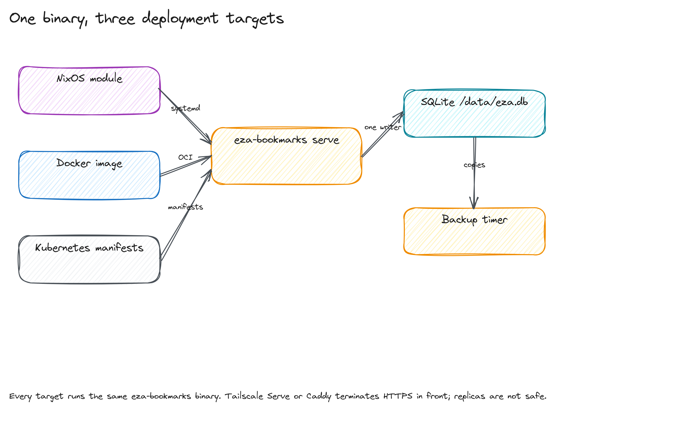

# Architecture

eza runs one Haskell process, serves one WebAssembly client, and stores every
row in one SQLite file. This document explains the request path, the import
math, the search model, and the deployment shape.

## One process, one file

A Warp/WAI process owns the HTTP surface. It serves `/assets/*` from
`EZA_STATIC_DIR`, renders the login/setup/recovery pages, and answers
`/api/v1/*`. The same process opens `data/eza.db` at startup and keeps one
write connection behind an `MVar`.

Every API route passes the table in `Eza.Server`. The table is deny-by-default,
so a new route without a guard returns 401. Unsafe methods also require the
`X-CSRF-Token` header. The browser holds a passkey and a session cookie; the
server stores only the SHA-256 hash of the session token.


The CLI commands (`import`, `export`, `verify`, `backup`,
`check-dead`) open the same file from a separate process. SQLite serializes
the writers, so a running server and a one-off CLI command do not corrupt the
database.

## Import math

The reference export contains `A = 9457` anchors. The importer keeps the
http(s) subset `H = 9453`, skips `N = 4` non-http anchors, and collapses
`D = 465` duplicate anchors by normalized URL. The unique bookmark count is

```
U = H - D = 9453 - 465 = 8988
```

The tag links come from the folder stack and the `TAGS` attribute. For each
bookmark `b`, let `T_b` be its tag set. The stored link count is

```
L = sum over b of |T_b| = 21316
```

The importer writes the rows, tags, and links in one transaction. A second run
matches all 8,988 URLs and inserts zero rows.


Two timestamps matter. `created_at` is the earliest `ADD_DATE` for the URL,
which preserves when the bookmark was saved. `added_at` records when eza first
saw the row, and the prune view uses it.

## Search model

The parser in `Eza.SearchQuery` splits a query into a text part and a set of
filters:

```
tag:<name>       exact tag filter
is:unread        is_read = 0
is:dead          is_dead = 1
link:<url>       outgoing wikilink target
-term            excluded term
```

For the text terms `t_1 ... t_k`, the server builds an FTS5 prefix expression:

```
match = "t_1"* AND ... AND "t_k"*
```

Each `tag:` filter adds a predicate over the join table. With `m` tag
filters, the predicate is

```
COUNT(DISTINCT bookmark_tags.tag_id) = m
```

The result order is

```
ORDER BY bm25(bookmarks_fts), bookmarks.created_at DESC
```

FTS5 computes `bm25` over the five indexed columns. The server then opens a
snippet window around the first matching term and returns at most the requested
page size.


The measured p95 on the 8,988-row database is 0.67 to 1.19 ms for FTS queries
and 9.5 to 12.2 ms for tag-filtered queries on an AMD Ryzen 7 5700X with GHC
9.10.3 and `-O1`. The full method is in [performance.md](performance.md).

## Storage invariants

SQLite runs with WAL, foreign keys, and a five-second busy timeout. The schema
creates FTS5 with the `porter unicode61` tokenizer and keeps it in sync with
insert, update, and delete triggers.

The triggers compare only `title`, `description`, `url`, `note_body`, and
`extracted_text`. Updating `is_read` or `last_opened_at` does not rewrite the
index.

Destructive actions write an undo snapshot first. The snapshot stores the full
`bookmarks` row and the tag names for the affected rows. `POST /api/v1/undo`
restores the most recent snapshot and deletes the snapshot row. The UI asks for
confirmation before merge or prune, and the API applies one snapshot at a time.

## Serving and caching

Static files are served from `EZA_STATIC_DIR`: pages at `/`, a fixed entry at
`/assets/app/index.js`, the WASM bundle, the stylesheet, and the fonts. Every
static response carries an ETag and `Cache-Control: no-cache`, so a browser
revalidates after a rebuild and gets a 304 when the file did not change. The
client shell is sent with `no-store`: the HTML always comes from the server.

`/sw.js` is generated per request with the build id that
`scripts/build-web.sh` writes to `static/app/build-id`. A rebuild therefore
installs a new service worker; the worker claims the open pages, and each tab
reloads once into the new build. A port that is already taken reports the
origin that is probably answering instead of a raw socket error.

## Deployment shape

All deployment targets run the same `eza-bookmarks` binary. The NixOS module
wraps it in a hardened systemd unit with `StateDirectory=eza`, a
SecretSpec-wrapped `ExecStart`, a `/healthz` probe, and a daily backup timer.
The Docker image runs as uid 10001 with `/data` as the state volume. The
Kubernetes manifests use one replica, a `Recreate` strategy, and a
`ReadWriteOnce` `PersistentVolumeClaim`.



Tailscale Serve or Caddy terminates HTTPS in front of the process. Set
`PUBLIC_ORIGIN` and `EZA_RP_ID` to the public hostname before registering the
first passkey.

## What the design leaves out

SQLite has one writer, so the deployment uses one replica. A second pod would
contend for the same file lock.

The client reads all data through the API: lists, detail views, and search
results come from the server. This keeps one data model.

The 2026-08-14 export seeded the new schema.
